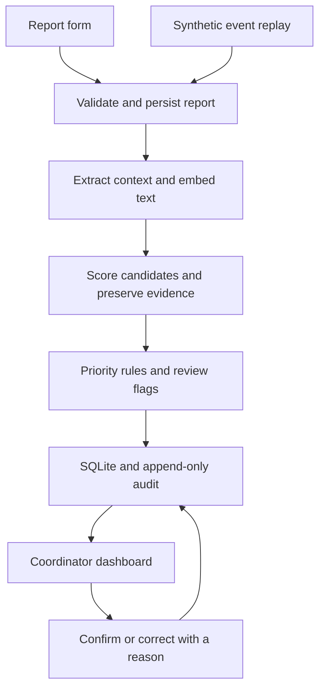

# Aegis: Emergency First-Response Coordination

Build plan for AI Innovate-A-Thon, Topic 10. Prepared 24 October 2026.

## 1. The product and the pitch

**Aegis turns a stream of campus incident reports into an evidence-backed incident board that a human coordinator can review and correct.**

The demo should tell one story: several people describe the same event differently, Aegis proposes a group, a conflicting update arrives, and the coordinator can inspect the evidence and decide what happens next.

Use this presentation line:

> Aegis combines semantic report matching, campus context, explicit priority rules, and reversible human decisions to help event coordinators make sense of fragmented incident reports.

The differentiation is the workflow: grouping evidence, uncertainty, conflicting reports, and corrections are visible in the same place. Treat this as a proposed system contribution to evaluate. Do not present the pretrained embedding model as a new algorithm or claim a first-ever emergency platform.

**Assumptions:** this is an overnight prototype for the 25 October demonstration; all reports and identities are synthetic; the primary user is one event coordinator; English text is the initial supported input. No existing code was found in this workspace.

## 2. Requirements and the evidence we must show

| Requirement from the brief | Implementation | Demonstration evidence |
| --- | --- | --- |
| Group reports about the same incident | Incremental semantic matching with location/time constraints | Differently worded reports join one provisional incident |
| Show evidence for grouping | Pairwise text similarity, shared location, time difference, supporting report IDs | A working “Why grouped?” panel |
| Transparent priority policy | Versioned deterministic rules separate from the AI score | A priority badge opens the exact rule and source phrase |
| Human coordinator remains in control | Confirm/reject grouping, move report, merge/split, override priority, change status | Correct one deliberate grouping error live |
| No automatic dispatch | Coordinator records decisions and notes only | No responder integration or automatic send action |
| No suppression because of low confidence | Persist every report; unresolved reports remain visible | An incomplete report appears in the review queue |
| Incident dashboard and audit trail | Incident queue, schematic map, report detail, audit timeline | Refresh preserves actions and their explanations |
| Duplicate, conflicting, incomplete test cases | Synthetic fixtures and automated evaluation | Results table plus three visible edge cases |
| Common submission requirements | README, architecture, dataset description, measured evaluation, report, PPT, demo video | A complete submission folder |

The source is the supplied PDF, Question 10 on page 4 and the common checklist on pages 8–9. The first page gives 24–25 October event dates; the repeated footer dates differ. Use the first-page schedule when planning, and check any later organiser announcement before submitting.

## 3. Scope that can ship

### Required for the demo

1. A polished coordinator dashboard that receives real backend data.
2. A small report form that works in a second tab or on a phone on the same trusted network.
3. Semantic grouping with inspectable evidence and conservative handling of ambiguity.
4. Explicit priority rules and a visible human review queue.
5. Conflict indicators tied to original report passages.
6. Reversible coordinator corrections and a persistent audit trail.
7. A deterministic, step-controlled event replay using the normal ingestion path.
8. A reproducible evaluation against a lexical baseline.

### Add only after the required flow passes

- A baseline-versus-Aegis replay view using the same input stream.
- A downloadable incident brief containing source report IDs and coordinator notes.
- A small evidence graph for the selected incident. Every edge must correspond to stored matching evidence.
- A projector-friendly light theme and a keyboard shortcut for advancing the replay.

### Defer

SMS/WhatsApp integrations, live emergency services, automatic dispatch, responder GPS, route optimisation, voice calls, multilingual support, native mobile apps, model training, production authentication, a public deployment, and a full digital campus twin.

These deferred features add failure points without strengthening the core demonstration. Label them as future work in the presentation.

## 4. User experience and visual design

Build an operations workspace, with the incident queue as the main visual focus.

| Surface | Contents and behaviour |
| --- | --- |
| Header | Aegis wordmark; event name; prominent “Synthetic exercise”; backend/model status; replay controls |
| Summary strip | Received reports; provisional incident groups; reports awaiting review; unresolved conflicts |
| Left: incident queue | Priority, location, short extractive title, report count, earliest unresolved age, review/conflict badge |
| Centre: campus schematic | Clearly labelled illustrative event map; selectable incident markers; unknown-location tray |
| Right: incident inspector | Source reports, grouping evidence, priority explanation, contradictions, coordinator actions |
| Bottom or inspector tab | Persistent audit timeline: actor, action, time, reason, before/after values |

At smaller laptop widths, keep the queue and map visible and open the inspector as a drawer. Do not squeeze four narrow columns onto a projector.

Use deep slate backgrounds, crisp white text, restrained blue for selection, amber for uncertainty, and red only for immediate-review priority. Pair colour with labels and icons. Use readable body text and high contrast; test on the actual projector. Animations should explain a report joining a group or an incident changing position, and respect reduced motion.

All counters must come from database queries. Label the incident count “provisional groups” until a human confirms it. Show age as “since first report,” not as a verified incident start time. Report counts are observations, not independent witnesses or evidence of truth.

### Screens/routes

- `/dashboard`: the main coordinator workspace.
- `/report`: concise submission form: description, known zone, optional sublocation/category, and optional event time.
- `/evaluation`: dataset version, baseline comparison, error examples, and test results.
- `/about`: short method, limitations, and implemented/planned feature list. This can be a drawer if time is tight.

Keep replay controls inside the dashboard. Avoid building a separate elaborate simulator application.

## 5. Architecture and stack

**Recommended stack:** React + TypeScript + Vite; ordinary CSS or Tailwind, whichever the team already knows; FastAPI; SQLite; Sentence Transformers with `sentence-transformers/all-MiniLM-L6-v2`; NumPy and scikit-learn for evaluation.

The embedding model is pretrained and produces 384-dimensional text vectors. Use it for semantic similarity, without fine-tuning. The model card and Sentence Transformers documentation are listed in the references.

Choose Python for the backend to keep the ML and API in one process. Adding a Go service tonight would introduce another interface to maintain. SQLite is enough for hundreds of reports; load their vectors into memory and compare them directly. No vector database, Redis, message broker, or separate inference server is required.

Start with dashboard polling every second. An actual backend can feel live without a WebSocket implementation. Add server-sent events only if polling becomes a demonstrated problem.



Persist the raw report before model processing. If embedding fails or times out, return a report ID and show a pending-analysis singleton in the dashboard. Run immediate-danger phrase checks before embedding completes. Model failure must not make a report disappear.

Download and cache the model before the venue demo, then confirm it loads with network access disabled. Pin the working dependency versions and model revision. Use one Uvicorn worker and one loaded model on the demo laptop. Run the small inference task outside the async request loop so dashboard reads remain responsive.

## 6. Data model and invariants

Use one active event for the MVP, but retain `event_id` on every record.

| Table | Important fields |
| --- | --- |
| `events` | id, name, start/end, timezone, exercise flag, policy version |
| `reports` | id, event_id, idempotency_key, raw_text, source_kind, zone_id, sublocation, reported_event_at, received_at, analysis_status |
| `report_analysis` | report_id, model revision, extraction version, embedding, extracted claims, exact text spans, analysis timestamps |
| `incidents` | id, event_id, extractive title, anchor_report_id, workflow_status, suggested_priority, effective_priority, review flags, row version |
| `memberships` | report_id, incident_id, provisional/confirmed state, created_by, evidence_id |
| `match_evidence` | report/candidate IDs, semantic score, context components, missing fields, decision, threshold/config version |
| `review_decisions` | action, selected reports/incidents, reason, actor, rejected grouping constraints |
| `conflicts` | incident_id, claim field, opposing report IDs/spans, unresolved/resolved state, coordinator note |
| `audit_events` | sequence, event_id, actor, action, affected IDs, before/after JSON, reason, recorded_at |

Core invariants:

- Every received report has an ID and stays accessible, including rejected, incomplete, or uncertain reports.
- Every report belongs to exactly one current provisional or confirmed incident. An ambiguous report begins as its own singleton with candidate links.
- Raw text stays unchanged. Corrections are annotations with an audit entry.
- Grouping, priority, and audit changes commit in the same database transaction.
- A repeated submission with the same idempotency key returns the original receipt and adds no report.
- A coordinator rejection prevents the next matching pass from silently recreating that rejected relationship.
- Human corrections update state and constraints; do not claim they retrain the embedding model.
- Persisted row versions reject stale competing edits with a clear refresh-and-retry message.
- All timestamps are stored with UTC offsets; the interface displays event-local time. The scenario clock is distinct from the actual time an audit entry is recorded.

An application-level append-only audit table is sufficient. Do not call it immutable against a database administrator, cryptographically secured, or tamper-proof.

## 7. AI grouping algorithm

### Step A: preserve and normalise

Store the original report. Normalise whitespace and known location aliases for analysis. Do not remove negations, numbers, person descriptions, or directional location words. Prefer a reporter-selected zone to a guessed location. If text and form location disagree, preserve both and raise a review flag.

Version the location dictionary, category rules, entity extraction, and matching settings in small configuration files. Show unknown when extraction is unsupported.

### Step B: create an embedding

Encode the text with MiniLM and normalise its vector. Store the model revision with the vector. Cosine similarity is a matching score, not a probability that two reports describe the same event.

Use deterministic, narrow extraction rules for the demo categories: medical incident, missing person, blocked exit, facility issue, and unknown/other. Use categories as supporting context; category agreement alone never establishes identity.

### Step C: retrieve plausible candidates

Compare only within the same event. Retrieve recent open incidents and allow wider windows for missing-person reports. Initial retrieval windows can be 20 minutes for short-lived event incidents and 120 minutes for missing-person cases; tune on the development fixtures.

Known incompatible zones, clearly different person/object descriptions, or explicitly separate events block automatic attachment. Such reports remain visible and can still be manually linked. Unknown time or location cannot be treated as agreement. Explicit references to an older incident can be shown as review candidates outside the default time window.

### Step D: score and explain

Initial development-only score:

`S = 0.65 × semantic + 0.20 × location + 0.10 × time + 0.05 × category`

Define each component in configuration: semantic is nonnegative cosine similarity; location distinguishes the same sublocation from only the same broad zone; time decays with the time gap; category uses a small compatibility table. If a field is missing, mark it missing and renormalise available weights for ranking. Missing evidence still blocks automatic attachment when required below.

Use an immutable first report or a human-confirmed exemplar as the group anchor. Compare against the anchor and up to three representative members; check for incompatibilities across the whole group. Do not build groups by taking connected components of all similar report pairs: A resembling B and B resembling C does not prove that A and C refer to the same event.

Illustrative starting thresholds, to be tuned on development data only:

- `S >= 0.82`, best-versus-runner-up margin at least `0.08`, anchor semantic similarity at least `0.62`, known compatible time, and sufficiently specific shared location/entity evidence: provisionally attach and mark reviewable.
- `0.65 <= S < 0.82`, a close runner-up, a missing required field, or any ambiguity: leave as a singleton and show suggested matches.
- Lower score: keep as a separate incident; still show it to the coordinator.

Meeting the numeric threshold cannot override a hard incompatibility or a previous human rejection. These numbers are hypotheses for calibration, not reported results or validated probabilities.

Save the actual contributing report IDs and component values for every decision. An evidence panel should read like: “same Exit A; reported 70 seconds apart; similar description; location supplied by reporter; provisional grouping.” Avoid a bare “92% confidence” badge.

### Step E: handle corrections

Allow confirm grouping, move a report to an existing/new incident, merge selected incidents, and split selected reports into a new incident. Splitting selected reports covers a practical merge reversal for the MVP. Each action requires a short reason and records the previous membership state. Recompute grouping summaries, priority suggestions, and conflict flags after the transaction.

No rejected or moved report is deleted. A correction constraint remains active for later arrivals until the coordinator explicitly changes it.

## 8. Transparent priority policy

This is an illustrative event-review policy, not a medical diagnosis or clinically validated triage protocol. Priorities order coordinator attention; they never dispatch anyone.

| Label | Prototype rule | Example evidence to display |
| --- | --- | --- |
| P0: immediate human review | A report explicitly alleges immediate danger under the team's documented exercise policy | Exact dangerous-condition phrase, source report ID, rule ID |
| P1: urgent review | A reported blocked exit, a potentially vulnerable missing person, or a medical incident without an explicit P0 signal | Category/context and triggering phrase |
| P2: standard review | A non-dangerous facility issue with enough context | Fault and location supplied by the reporter |
| Unassessed: needs review | Insufficient information or failed/unsupported analysis | Missing fields or analysis failure |

Keep “Unassessed” visible in a dedicated lane; do not silently map it to the lowest priority. Sort assessed incidents by priority, then earliest unresolved report. Keep overdue and unassessed review items visible alongside that queue.

Within an incident, the most urgent reported unresolved claim sets the suggested priority. Additional duplicate reports do not prove severity. A reassuring update does not automatically downgrade an incident or resolve a conflict. A coordinator can override the effective priority with a reason; show the suggestion and override together.

If new higher-risk evidence arrives after an override, keep the human's recorded decision, add an immediate “new risk evidence: re-review” flag, and make the escalation visible. Do not bury it behind the old override or silently erase the override.

Use bounded negation-aware phrase rules for the exercise, with explicit tests. “No fire observed,” “not unconscious,” and a quoted hypothetical must not be handled as simple keyword matches. Mark unsupported phrasing for review and acknowledge that phrase rules have limited coverage.

## 9. Conflicting and incomplete reports

Implement narrow claim comparison rather than claiming unrestricted natural-language contradiction detection.

Supported claim fields can include `exit_access: blocked/clear`, `reported_condition: responsive/unresponsive`, and `person_status: missing/found`. Each extracted claim includes report ID, phrase span, time, and whether it is explicit or uncertain.

Two opposing claims about a compatible incident produce **“conflicting or changing reports: review required.”** Different timestamps may indicate a real change, so do not label a reporter as wrong. “I cannot tell whether the exit is blocked” is unknown, not a clear-exit claim.

The coordinator can record a clarification or resolution. Preserve the earlier claims and their history. Unknown location belongs in an “unlocated” tray, never a fabricated precise map point. An incomplete report can be supplemented through an annotated correction without editing its original text.

## 10. API contract

Return typed JSON with stable IDs, UTC timestamps, and analysis state. Use a predictable validation/error shape.

| Endpoint | Purpose |
| --- | --- |
| `GET /api/health` | Backend readiness, model readiness/revision, current analysis mode |
| `GET /api/events/current` | Event metadata, zones, policy/config versions |
| `POST /api/reports` | Persist an idempotent report and return its receipt/analysis state |
| `GET /api/reports` | Searchable raw-report feed, including uncertain and pending reports |
| `GET /api/incidents` | Current provisional/confirmed groups and queue summaries |
| `GET /api/incidents/{id}` | Members, match evidence, claims, priority explanation, available actions |
| `POST /api/reviews/grouping` | Confirm, reject, move, merge, or split using explicit report/incident IDs |
| `POST /api/incidents/{id}/priority` | Human override, reason, actor and expected row version |
| `POST /api/incidents/{id}/status` | Open, acknowledged, monitoring, resolved; manual transition with reason |
| `POST /api/conflicts/{id}/review` | Coordinator clarification or resolution |
| `GET /api/audit` | Ordered persistent audit entries |
| `POST /api/demo/session` | Start a separate synthetic exercise session |
| `POST /api/demo/session/{id}/next` | Ingest the next scenario report through the ordinary pipeline |
| `GET /api/evaluation/latest` | Saved measured results, fixture/model/config versions, errors |

Use an event-scoped snapshot response for dashboard polling if that is simpler than multiple requests. Demo controls must operate only on exercise sessions. Starting a new run should create a new event/session, preserving the previous audit history.

## 11. Synthetic data and evaluation

### Fixtures

Plan for 144 reports covering 48 underlying incidents:

- Demo scenario: 24 reports / 8 incidents. Manually authored and reviewed; never count these as held-out evaluation.
- Development: 60 reports / 20 incidents. Tune aliases, weights, thresholds, and extraction here.
- Held-out test: 60 reports / 20 distinct incidents. Freeze before tuning and run after configuration is locked.

Assign complete incident bundles and paraphrase/template families to one split. Vary wording, people, zones, timing, and event descriptions across splits. Do not distribute near-identical paraphrases of the same scenario between development and test. A pretrained model needs no local training split; describe this as development/test evaluation, without pretending to have trained the encoder.

Include exact duplicates, paraphrases, similar but distinct nearby incidents, repeated source submissions, evolving conditions, opposing accounts, missing fields, location aliases, typos, negations, unsupported language, old timestamps, and a severe singleton among many minor reports.

Fixture labels: ground-truth incident ID, expected policy priority, expected explicit claim(s), known conflict/update pairs, missing-information flags, and expected review behaviour. Keep labels in evaluation-only files; the application pipeline must never read them.

One teammate writes cases and another checks labels where staffing allows. Record any ambiguous label decisions rather than forcing agreement silently.

### Baselines and metrics

Compare these methods on the identical ordered stream, before human correction:

1. **Lexical baseline:** word/character TF-IDF cosine similarity.
2. **Semantic baseline:** MiniLM similarity without the extra context score.
3. **Aegis:** MiniLM plus contextual evidence and conservative attachment rules.

Use the same event boundary, ingestion semantics, output representation, and documented evaluation protocol. Tune each method's thresholds only on development data. Document any differing gates; do not conceal an easier candidate set for Aegis. Fit TF-IDF vocabulary/IDF on development text only, then transform the held-out text.

| Metric | What it demonstrates |
| --- | --- |
| Pairwise grouping precision, recall, F1 | Whether reports from the same incident share a predicted group |
| False merges and missed duplicate pairs | Concrete grouping failures hidden by an aggregate score |
| Review/singleton rate | How much ambiguity is deferred to the coordinator |
| Priority confusion table and P0 misses | Whether the implemented rules match the team's labelled exercise policy |
| Supported conflict detection precision/recall | Performance only on the documented claim types |
| Raw-report retention and audit completeness | Whether any report/action disappears |
| Receipt latency and analysis-to-dashboard p50/p95 | Actual behaviour on the named demo hardware |

Run three fixed stream orders to expose order sensitivity. Publish per-order results and a summary. Keep provisional and human-corrected results separate. Repeated runs on a small synthetic set are not independent evidence of real-world accuracy.

Initial acceptance targets, not claimed results: 100% retention, 100% tested coordinator actions audited, zero automatic external sends, zero P0 misses on the explicit policy fixtures, grouping precision at least 0.90 on the small held-out set, and analysis-to-dashboard p95 under 2 seconds after model warm-up on the demo laptop. Report actual recall, review rate, and failures even if targets are missed. Avoid achieving perfect precision merely by grouping nothing.

Define `1 - predicted_group_count / report_count` as **interface consolidation**, not accuracy, response-time improvement, or proof of saved lives. Give operational improvement claims only after a controlled coordinator task study; otherwise present them as goals.

## 12. Four-minute demonstration

The full exercise has 24 reports. Use a shorter rehearsed excerpt for the live presentation.

| Time | Action | Visible payoff |
| --- | --- | --- |
| 0:00–0:25 | Open the raw report feed; explain the coordinator's problem | Fragmented incoming information |
| 0:25–1:05 | Advance several differently worded reports about one medical incident | One provisional incident with original reports retained |
| 1:05–1:35 | Open “Why grouped?” and the priority explanation | Specific, inspectable evidence instead of a mystery score |
| 1:35–2:10 | Add a similar report in another zone, then an incomplete report | Separate incidents and a visible review item |
| 2:10–2:45 | Add “exit blocked” and a later “exit clear” account | A conflict/change flag; no automatic closure |
| 2:45–3:25 | Correct one deliberately ambiguous grouping; record a priority decision | Human control and immediately updated audit trail |
| 3:25–4:00 | Open evaluation and one known failure | Baseline comparison, measured limits, credible conclusion |

Have a team member submit one unseen synthetic wording through `/report` during rehearsal, and try it again live if stable. That demonstrates working ingestion beyond the replay script.

Replay controls: next, pause, restart as a new session, and optional timed play. Use deterministic input order and scenario time, but execute real matching and priority logic. Never hardcode expected incident IDs into ingestion or prefill evaluation numbers. Maintain separate empty, busy, and edge-case exercise scenarios for recovery.

## 13. Implementation order and time budget

Plan around approximately 20–24 elapsed hours, with three workstreams if three people are available. For a smaller team, execute the same phases sequentially and cut optional features early. The estimates are planning ranges, not a guaranteed completion time.

| Phase | Elapsed time | Concrete exit condition |
| --- | --- | --- |
| 1. Contract and setup | Hours 0–1 | Lock stack, schema, event zones, UI layout, API shapes, demo story; verify model loads |
| 2. Vertical slice | Hours 1–4 | Submit report → SQLite → real dashboard → refresh persistence → audit receipt |
| 3. Intelligence | Hours 4–8 | Embeddings, candidate checks, grouping evidence, priority policy, incomplete-report path |
| 4. Human review | Hours 8–11 | Confirm/reject/move/merge/split, priority override, conflict review, transactional audit |
| 5. Demo surface | Hours 11–14 | Map, responsive inspector, replay controls, clear state transitions, empty/error states |
| 6. Evaluation | Hours 14–17 | Frozen fixtures, baseline runs, metrics, error analysis, exported results |
| 7. Submission and rehearsal | Hours 17–20 | Concise report/PPT, screenshots, video backup, complete end-to-end rehearsal |
| Buffer | Remaining time | Fix failures; do not start new integrations |

Produce and review synthetic fixtures during phases 1–4 so evaluation does not begin with an empty dataset. With the event ending at 17:00 IST on 25 October according to page 1, aim to freeze features by 11:00 IST, finish evidence and recording by 14:00, and reserve the remaining time for rehearsal and organiser instructions. If these gates are already past when implementation begins, reduce scope.

### Workstreams, if staffed

| Owner | Responsibility | Early integration contract |
| --- | --- | --- |
| Backend/AI | SQLite, API, grouping, policy, corrections, audit | Typed example responses in the first hour |
| Frontend/product | Dashboard, report form, map, inspector, replay controls | Real ingestion connected by hour 4 |
| Data/evaluation/presentation | Synthetic fixtures, independent label review, baseline runner, slides/report/demo | Demo fixtures by hour 3; frozen test set before tuning |

This is a suggested team division, not a requirement to use separate AI agents.

### Fallback cuts

- If the model still cannot load by hour 2, fix packaging before polishing. Use TF-IDF as a clearly labelled degraded mode while retaining the semantic path as an explicit blocker; do not quietly call lexical matching semantic AI.
- If backend/frontend integration is late by hour 4, stop visual extras and connect the real vertical slice.
- If core review is unfinished by hour 11, remove evidence graph, extra themes, exports, and animation. Retain correction actions, conflict visibility, and audit.
- If time becomes critical, reduce benchmark size and report the resulting limitation. Preserve the representative duplicate, conflicting, and incomplete cases required by the brief.
- Run locally from a single laptop first. Phone/LAN access and hosting are optional enhancements.

## 14. Suggested repository layout

```text
aegis/
  frontend/
    src/components/
    src/pages/
    src/api/
    src/types/
  backend/
    app/api/
    app/services/ingestion.py
    app/services/grouping.py
    app/services/claims.py
    app/services/priority.py
    app/services/review.py
    app/db/
    tests/
  config/
    locations.json
    policy.json
    matching.json
  data/
    demo/
    dev/
    test/
  evaluation/
    run.py
    baselines.py
    results/
  docs/
    architecture.md
    dataset.md
    demo-script.md
  README.md
  AEGIS_BUILD_PLAN.md
```

Separate runtime report inputs from evaluation labels. Add lockfiles, a minimal environment example, and a one-command local startup script after the stack works. Keep synthetic fixture versions and measured results in the repository. Exclude virtual environments, downloaded model caches, and mutable runtime databases from source control.

## 15. Verification that matters

Write meaningful tests for the risk-bearing state and matching behaviour:

- Two paraphrases with compatible context can group; similar reports about distinct people/zones do not automatically group.
- A bridge report cannot transitively collapse two incompatible incidents.
- Missing location/time and low similarity preserve a visible reviewable singleton.
- Model failure preserves the receipt and report, and the rules/review path stays usable.
- A severe singleton remains visible among many low-priority duplicates.
- Negated and hypothetical phrases do not trigger the corresponding affirmative claim.
- Conflicting accounts preserve the more urgent unresolved suggestion and never auto-resolve.
- A coordinator rejection survives later ingestion and refresh.
- Merge/split/move updates memberships, priority suggestions, conflicts, and audit together.
- Retrying ingestion is idempotent; stale concurrent edits are rejected; restart preserves state.
- New higher-risk evidence after a human override creates a prominent re-review flag.
- Keyboard navigation, labels, colour-independent priorities, and empty/error/loading states work.

Run the full replay twice from fresh exercise sessions and once after restarting the backend. Test network-disabled model startup, laptop-only presentation, a fresh report form submission, and a failed backend connection. Record the known failures in the evaluation view.

## 16. Presentation, novelty, and likely questions

### Claims that can be demonstrated

| Proposed contribution | What must exist to claim it |
| --- | --- |
| Context-aware semantic report grouping | Measured comparison with lexical and semantic baselines |
| Evidence-backed grouping | Saved source IDs and component evidence visible in the UI |
| Conflict-preserving coordination | Opposing claims stay visible through grouping and resolution |
| Reversible human oversight | Real correction actions plus durable before/after audit entries |
| Local operation | Model and application demonstrably work with network access disabled |
| Reproducible event replay | Replay uses the normal pipeline and a documented scenario clock |

Use the phrase **“our prototype's contribution”** for the combination. Incident maps and crowdsourced crisis reporting already exist, including Ushahidi. Semantic embeddings are established technology. Any stronger originality claim needs a real prior-art comparison.

### Seven-slide presentation

1. Coordinator problem and fragmented reports.
2. Aegis workflow and the specific system contribution.
3. Architecture and the separation of semantic matching from priority rules.
4. Live demonstration.
5. Dataset, baseline metrics, errors, and measured latency.
6. Human oversight, limitations, accessibility, privacy, and SDG alignment.
7. Implemented features, deferred features, and next experiment.

Connect to SDG 11 through safer, more resilient event coordination, and secondarily to SDG 3 through supporting timely human attention to reported incidents. Describe this as intended alignment, not a measured health outcome.

### Likely questions

- **Where is the AI?** The pretrained sentence encoder creates semantic vectors; the matcher combines them with event context. Priority and coordinator actions are explicit rules and human decisions.
- **What did you train?** No encoder training for this prototype. We calibrated matching settings on synthetic development cases and evaluated on separate incident families.
- **What is novel?** The evaluated integration of context-aware grouping, inspectable evidence, conflict preservation, and reversible review in a campus exercise workflow.
- **Can it make mistakes?** Yes. Show a failure and the correction path; the raw reports remain visible.
- **Is confidence a probability?** No. Similarity and the composite match score are uncalibrated ranking signals.
- **Does it work in emergencies?** It is a synthetic coordination prototype. Real use needs stakeholder-defined policies, security, operational testing, and validation beyond these fixtures.
- **Can it understand every contradiction?** No. Claim comparison supports the documented fields; other uncertainty goes to review.

## 17. Deliverables and definition of done

The project is ready when a fresh exercise session can receive new text, form sensible provisional incident groups, explain the grouping and priority, preserve a conflict, allow a correction, and retain the full history after refresh/restart.

Deliver:

- Working application and reproducible startup instructions.
- Versioned synthetic demo/development/test fixtures and label definitions.
- Frozen model/config versions and baseline/evaluation runner.
- Measured results with known failures and limitations.
- Short report covering every common submission item.
- Seven-slide presentation with screenshots from the actual build.
- Rehearsed four-minute demonstration and a short backup recording.
- Clear implemented-versus-planned feature table.

The polished surface matters most when every visible explanation, count, and action is backed by real state. Spend the final hours on that consistency and rehearsal.

## References

1. Supplied `AI_Innovate_A_Thon__Questions(1).pdf`, Question 10, page 4; common checklist and presentation flow, pages 8–9; schedule, page 1.
2. Sentence Transformers semantic textual similarity documentation: https://sbert.net/docs/sentence_transformer/usage/semantic_textual_similarity.html
3. Official MiniLM model card: https://huggingface.co/sentence-transformers/all-MiniLM-L6-v2
4. Sentence-BERT paper: https://arxiv.org/abs/1908.10084
5. FastAPI model startup/lifespan documentation: https://fastapi.tiangolo.com/advanced/events/
6. Vite setup documentation: https://vite.dev/guide/
7. Ushahidi's description of report collection, review, maps, and activity views: https://www.ushahidi.com/about/blog/how-the-ushahidi-platform-works-and-what-comes-next
8. UN SDG 11: https://sdgs.un.org/goals/goal11
9. UN SDG 3: https://sdgs.un.org/goals/goal3
