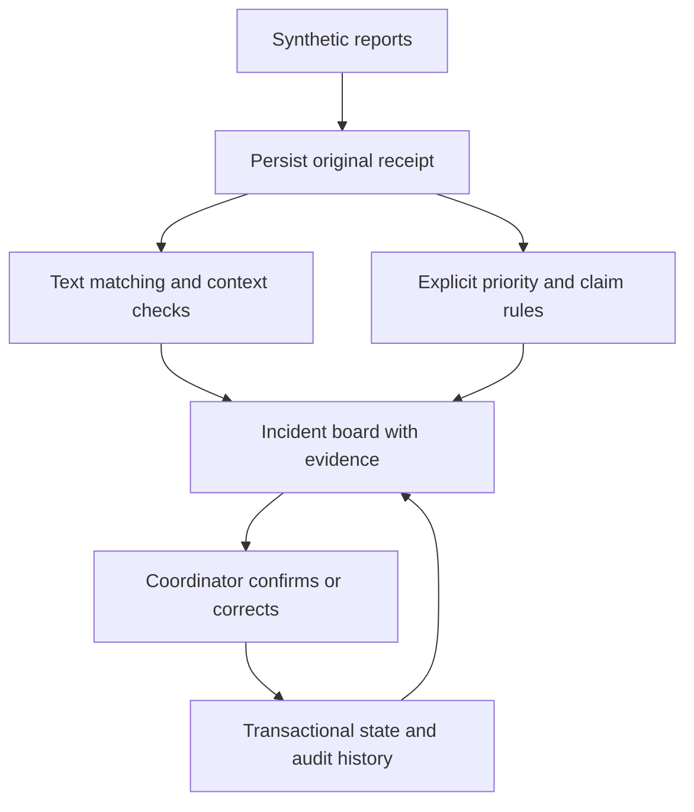

# Aegis: Emergency First-Response Coordination

## Problem and intended user

During a campus event, several organisers can receive overlapping reports about the same situation. Differences in wording, missing locations, and later updates make it difficult to distinguish separate incidents from duplicate accounts. Aegis gives a human coordinator a shared incident board for a synthetic exercise.

The prototype implements Question 10 of the supplied AI Innovate-A-Thon brief. Its purpose is coordination and review. It does not diagnose conditions, contact emergency services, dispatch responders, or establish whether a reported claim is true.

## Implemented workflow

The report form captures text, a known or unknown zone, an optional specific location, and an optional event-local time. The backend commits the original report and a visible provisional incident before analysis. It then extracts supported claims, computes a text representation, checks candidate incidents, and stores the grouping evidence and explicit priority suggestion.

The coordinator can inspect every original report, confirm selected membership, reject a pairing, move reports, merge or split groups, override a priority, review a conflicting account, and change workflow status. Each mutation requires a reason and checks the version the coordinator reviewed. Corrections and audit entries commit together.

## Implementation

| Area | Implementation |
| --- | --- |
| Frontend | TanStack Start, React, TypeScript, Bun and Vite |
| Components | shadcn Base UI primitives and official Nova style rules; neutral/orange preset |
| Backend | FastAPI, Pydantic, Python 3.14 and SQLite |
| Text matching | Optional local-only MiniLM adapter; deterministic lexical-hash fallback |
| Human review | Version-checked coordinator mutations with retained source reports |
| Reproducibility | Versioned synthetic JSON, replay through normal ingestion, executable evaluation |

The requested `b3PkSQ` preset was decoded using the official cached registry. Shell networking prevented completion of its remote bootstrap command. Its source configuration and upstream component styles were applied directly. Figtree is self-hosted through a locked font package and bundled into the build.

## Method and contribution

The semantic adapter supports the pretrained `sentence-transformers/all-MiniLM-L6-v2` encoder. The verification environment did not contain its package and weights, so the measured run used the explicitly labelled lexical-hash fallback. No encoder training or real MiniLM inference is claimed for that run.

Candidate checks combine text similarity, compatible time, location and category evidence. Automatic provisional attachment requires specific shared location or entity context and checks against the group's members; similarity chains alone cannot collapse distinct incidents. Lexical and semantic modes have separate, versioned thresholds. The lexical composite threshold was calibrated on development fixtures. Matching version 2 additionally requires at least 0.05 lexical anchor similarity so shared context cannot attach textually unrelated reports. This conservative correction lowers synthetic recall; see `docs/REVIEW.md`.

Priority follows the documented exercise rules. Low confidence does not delete a report or hide it from review. Supported opposing claims produce a conflicting-or-changing account flag. A later reassuring account does not automatically close an incident or cancel an unresolved urgent claim.

The proposed contribution is the integration of inspectable matching evidence, conflict preservation, and reversible coordinator decisions in one campus exercise workflow. Sentence embeddings, incident maps, and crowdsourced reporting are established techniques. A first-ever or clinically validated system claim would not be supported by this prototype.

## Dataset

All reports and identities are synthetic. The schematic locations are illustrative and are not a real evacuation map.

| Split | Reports | Underlying incident families | Use |
| --- | ---: | ---: | --- |
| Demo | 24 | 8 | Rehearsed replay |
| Development | 60 | 20 | Configuration and threshold development |
| Test/regression | 60 | 20 | Fixed regression measurements |

Runtime inputs and ground-truth labels live in separate files. The matcher never reads incident-family labels. Categories and coordination patterns recur across splits, and test cases were inspected during engineering. These results therefore describe a small synthetic regression set, not untouched operational generalisation.

## Measured results

The saved measurement is `evaluation/results/latest.json`. Pairwise grouping metrics count report pairs; the review rate describes reports deferred for human attention.

| Method | Precision | Recall | F1 | False merge pairs | Missed pairs | Review rate |
| --- | ---: | ---: | ---: | ---: | ---: | ---: |
| Token-set Jaccard baseline | 1.000 | 0.061 | 0.114 | 0 | 62 | 8.3% |
| Aegis contextual lexical fallback | 1.000 | 0.621 | 0.766 | 0 | 25 | 100% |

All six explicit evaluation checks passed: retention, fixture cardinality, explicit P0 cases, negative priority controls, changing-report visibility, and incomplete-report reviewability. These are finite fixture checks, not proof of unrestricted natural-language understanding.

The complete API replay retained 24 reports in 8 groups, exposed 3 conflicting report pairs, and recorded 50 audit events. A conflict count is a count of opposing report evidence, not a count of independently verified events. The fallback deliberately marks its limitations for review, explaining the 100% review rate; that should not be presented as coordinator workload eliminated.

## Engineering verification

The backend and fixture generator reached 100% statement and branch coverage. Tests include malformed inputs, exact source retention, idempotency conflicts, event isolation, model failure, correction semantics, stale versions, and deterministic concurrency races. A cross-language integration test executes the frontend grouping helper with Bun and submits its real payloads to FastAPI for all five grouping actions.

The frontend has explicit coverage gates for statements, branches, functions and lines. Build, interaction and coverage outcomes are recorded separately in `docs/VERIFICATION.md`. The live Chromium smoke test now exercises both running services through replay, report intake, grouping confirmation, audit inspection, and evaluation, and asserts that no uncaught browser errors occur.

## Responsible use, limitations and next work

The prototype uses synthetic records, preserves uncertainty, exposes reasons, and keeps a human in control. Labels and text accompany colour, report entry has a manual form, and map markers support keyboard selection. No external messages or automatic dispatch path exists.

Remaining deployment work includes operational stakeholder review, access control, security hardening, policy approval, a larger independent dataset, real-device accessibility testing, and validated model performance across language and wording variation. Do not use the prototype as a live emergency system.

The intended SDG alignment is SDG 11 through more resilient coordination, with secondary relevance to SDG 3 through timely human attention. No reduction in injuries, response time or deaths was measured.

## References

- Supplied AI Innovate-A-Thon problem brief, Question 10 and common submission checklist.
- https://sbert.net/docs/sentence_transformer/usage/semantic_textual_similarity.html
- https://huggingface.co/sentence-transformers/all-MiniLM-L6-v2
- https://arxiv.org/abs/1908.10084
- https://ui.shadcn.com/docs/cli
- https://www.ushahidi.com/about/blog/how-the-ushahidi-platform-works-and-what-comes-next
- https://sdgs.un.org/goals/goal11
- https://sdgs.un.org/goals/goal3
