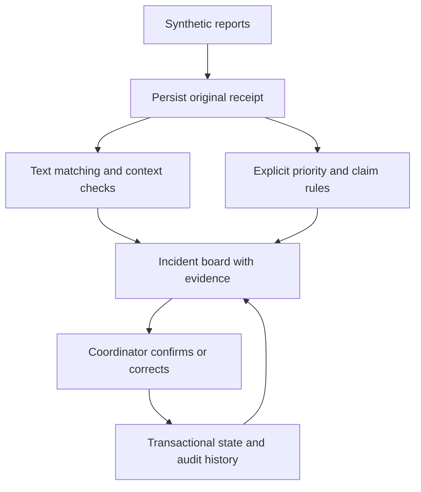

# Aegis: Emergency First-Response Coordination

## Problem and intended user

During a campus event, several organisers can receive overlapping reports about the same situation. Differences in wording, missing locations, and later updates make it difficult to distinguish separate incidents from duplicate accounts. Aegis gives a human coordinator a shared incident board for a synthetic exercise.

The prototype implements Question 10 of the supplied AI Innovate-A-Thon brief. Its purpose is coordination and review. It does not diagnose conditions, contact emergency services, dispatch responders, or establish whether a reported claim is true.

## Implemented workflow

The report form captures text, a known or unknown zone, an optional specific location, and an optional event-local time. The backend commits the original report and a visible provisional incident before analysis. It then extracts supported claims, computes a text representation, checks candidate incidents, and stores the grouping evidence and explicit priority suggestion.

The coordinator can inspect every original report, confirm selected membership, reject a pairing, move reports, merge or split groups, override a priority, review a conflicting account, and change workflow status. Each mutation requires a reason and checks the version the coordinator reviewed. Corrections and audit entries commit together.

## Implementation

| Area | Implementation |
| --- | --- |
| Frontend | TanStack Start, React, TypeScript, Bun and Vite |
| Components | shadcn Base UI/Nova primitives and restrained neutral surfaces |
| Backend | FastAPI, Pydantic, Python 3.14 and SQLite |
| Text matching | Pinned local MiniLM plus independently scored lexical evidence; labelled lexical fallback |
| Human review | Version-checked coordinator mutations with retained source reports |
| Reproducibility | Versioned synthetic JSON, replay through normal ingestion, executable evaluation |

The requested `b3PkSQ` preset was decoded using the official cached registry. Shell networking prevented completion of its remote bootstrap command. Its source configuration and upstream component styles were applied directly. Figtree is self-hosted through a locked font package and bundled into the build.

## Method and contribution

The semantic environment runs the pretrained `sentence-transformers/all-MiniLM-L6-v2` encoder at a pinned revision. Real offline inference, evaluation and ingestion through the API have been executed. `make dev-semantic` requires successful inference before starting the demo. No model training or paid inference API is used.

Candidate checks combine text similarity, compatible time, location and category evidence. The hybrid scores lexical and semantic routes independently, checks every group member, retains the first-report anchor, and exposes close alternatives. A compatible semantic anchor must corroborate a lexical attachment. Source-supported uncertainty, conflicting location information and coordinator rejections stay reviewable. The selected semantic composite threshold is 0.76; anchor corroboration is 0.62. These are development operating choices, not probabilities.

Two integration defects were corrected: bare equipment/location nouns no longer establish a facility fault, and a fallback member cannot weaken the semantic anchor's safeguards. Group ranking now includes all members, and evidence distinguishes the pair score from the group mean. Supported opposing claims remain visible even when their reports are left in different provisional groups; a coordinator can compare and merge them without losing the original accounts. See `docs/MATCHING.md` for the full method and calibration record.

Priority follows the documented exercise rules. Low confidence does not delete a report or hide it from review. Supported opposing claims produce a conflicting-or-changing account flag. A later reassuring account does not automatically close an incident or cancel an unresolved urgent claim.

The proposed contribution is the integration of inspectable matching evidence, conflict preservation, and reversible coordinator decisions in one campus exercise workflow. Sentence embeddings, incident maps, and crowdsourced reporting are established techniques. A first-ever or clinically validated system claim would not be supported by this prototype.

## Dataset

All reports and identities are synthetic. The schematic locations are illustrative and are not a real evacuation map.

| Split | Reports | Underlying incident families | Use |
| --- | ---: | ---: | --- |
| Demo | 24 | 8 | Rehearsed replay |
| Development | 60 | 20 | Configuration and threshold development |
| Test/regression | 60 | 20 | Fixed regression measurements |

Runtime inputs and ground-truth labels live in separate files. The matcher never reads incident-family labels. Categories and coordination patterns recur across splits, and test cases were inspected during engineering. These results therefore describe a small synthetic regression set, not untouched operational generalisation.

A separate development challenge contains 48 context-matched pairs (96 report records): 18 same-event scenarios, 18 explicitly distinct scenarios and 12 underdetermined scenarios. Pair members share known location and time, preventing those fields alone from separating them. Cases were frozen before scoring, then used for development calibration; they are not an independent test set. Labels encode synthetic author assumptions and cannot make unavailable identity information observable.

## Measured results

The saved measurements are `evaluation/results/latest.json` and `evaluation/results/semantic.json`. Pairwise grouping metrics count report pairs; the review rate describes reports with a review reason. Semantic and forced-lexical production runs use the same ordered input and decision policy.

| Method | Precision | Recall | F1 | False merge pairs | Missed pairs | Review rate |
| --- | ---: | ---: | ---: | ---: | ---: | ---: |
| Token-set Jaccard baseline | 1.000 | 0.061 | 0.114 | 0 | 62 | 8.3% |
| Aegis contextual lexical fallback | 1.000 | 0.652 | 0.789 | 0 | 23 | 100% |
| Aegis hybrid with real MiniLM | 1.000 | 0.197 | 0.329 | 0 | 53 | 96.7% |

Hybrid recall improves from the original semantic prototype's 0.030, but it still leaves more same-event pairs apart than lexical matching on this easy-context regression set. Its benefit appears in the context-matched development challenge: hybrid attaches 12 of 18 same-event pairs and no explicitly distinct pairs, while current lexical settings attach 17 same-event pairs but also 15 of 18 distinct pairs. Both methods surface candidates for all 18 same-event scenarios. Hybrid still proposes membership on 4 of 12 underdetermined scenarios and suggests 17 distinct scenarios, so review remains necessary and noisy.

A development sweep also calibrated a more conservative lexical control to the same zero-distinct-attachment target. At lexical thresholds of 0.60 or higher it met that target, but recovered none of the original development stream's 66 same-event pairs. The hybrid recovered 22 of 66. These matched-budget diagnostics support a limited development-data benefit from dense evidence; they do not establish operational accuracy. A small STS cross-encoder was tested and rejected because it did not provide sufficient benefit. Its weights remain outside the runtime.

All six explicit evaluation checks passed: retention, fixture cardinality, explicit P0 cases, negative priority controls, changing-report claim detection, and incomplete-report reviewability. Policy and conflict-detector checks supply ground-truth memberships; passing them does not establish that automatic grouping joined those reports. These are finite component checks, not proof of unrestricted natural-language understanding.

The real-model API replay retained all 24 reports in 19 provisional groups with 50 audit entries; no within-group conflict objects appeared automatically. A separate fresh-intake API check grouped two projector paraphrases, kept a sound-monitor problem separate at the same location/time, retained an incomplete unassessed report, and preserved blocked/clear doorway claims through coordinator review. Conflicts count opposing report evidence, not verified events. Group counts and review flags should not be presented as measured coordinator time saved.

## Engineering verification

The backend and fixture generator reached 100% statement and branch coverage. Tests include malformed inputs, exact source retention, idempotency conflicts, event isolation, model failure, correction semantics, stale versions, and deterministic concurrency races. A cross-language integration test executes the frontend grouping helper with Bun and submits its real payloads to FastAPI for all five grouping actions.

The frontend has explicit coverage gates for statements, branches, functions and lines. Build, interaction and coverage outcomes are recorded separately in `docs/VERIFICATION.md`. The live Chromium smoke test now exercises both running services through replay, report intake, grouping confirmation, audit inspection, and evaluation, and asserts that no uncaught browser errors occur.

## Responsible use, limitations and next work

The prototype uses synthetic records, preserves uncertainty, exposes reasons, and keeps a human in control. Labels and text accompany colour, report entry has a manual form, and map markers support keyboard selection. No external messages or automatic dispatch path exists.

Remaining deployment work includes operational stakeholder review, access control, security hardening, policy approval, a larger independent dataset, real-device accessibility testing, and validated model performance across language and wording variation. Do not use the prototype as a live emergency system.

The intended SDG alignment is SDG 11 through more resilient coordination, with secondary relevance to SDG 3 through timely human attention. No reduction in injuries, response time or deaths was measured.

## References

- Supplied AI Innovate-A-Thon problem brief, Question 10 and common submission checklist.
- https://sbert.net/docs/sentence_transformer/usage/semantic_textual_similarity.html
- https://huggingface.co/sentence-transformers/all-MiniLM-L6-v2
- https://arxiv.org/abs/1908.10084
- https://ui.shadcn.com/docs/cli
- https://www.ushahidi.com/about/blog/how-the-ushahidi-platform-works-and-what-comes-next
- https://sdgs.un.org/goals/goal11
- https://sdgs.un.org/goals/goal3
